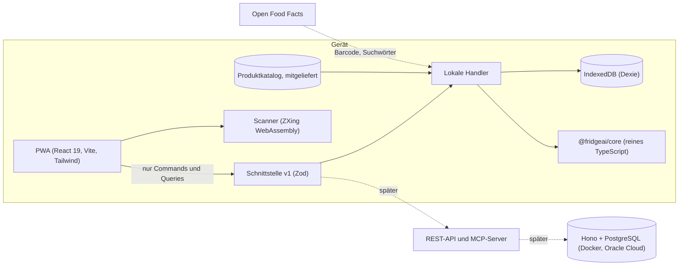

# Rettich 🥬

[](https://github.com/BanioX/Rettich/actions/workflows/ci.yml)

Bis 7.11.2026 hiess die App «FridgeAI». Das Repo heisst seit 14.11.2026 `BanioX/Rettich`; Paketnamen, Datenbank und Web-Adresse heissen technisch weiter so ([ADR-0032](docs/adr/0032-name-rettich.md)).

**Wirf kein Geld in den Abfall.** Rettich, wie «rett' ich».

> **Scan deine Quittung – Rettich weiss, was du hast, wem es gehört, wer was schuldet und was du heute retten musst.**

Local-first PWA für Schweizer Haushalte (WGs, Paare, Familien). Rettich zeigt dir, was mit deinen Lebensmitteln passiert: was du verwertest, was du entsorgst und was es kostet ([ADR-0046](docs/adr/0046-awareness-verwertet-entsorgt.md)). Alles läuft offline auf dem Gerät: Quittungen, Barcodes und Nährwerttabellen liest Rettich selbst, ohne Cloud-KI und ohne Konto.

**Product Owner:** Alban Hyseni · **Stand:** Version 0.21.0 ([Releases](https://github.com/BanioX/Rettich/releases), [Änderungen](CHANGELOG.md)), im Pilot ([`docs/pilot.md`](docs/pilot.md)); Teilen im Haushalt folgt · **Lizenz:** proprietär, alle Rechte vorbehalten

---

## Inhalt

- [Was die App heute kann](#was-die-app-heute-kann)
- [Am Handy ausprobieren](#am-handy-ausprobieren)
- [Am Rechner entwickeln](#am-rechner-entwickeln)
- [Architektur](#architektur)
- [Projektstruktur](#projektstruktur)
- [Arbeitsweise](#arbeitsweise)
- [Datenschutz und Sicherheit](#datenschutz-und-sicherheit)
- [Dokumentation](#dokumentation)
- [Lizenz](#lizenz)

## Was die App heute kann

Unten fünf Tabs: **Start · Vorrat · ＋ Erfassen · Wissen · Mehr** ([ADR-0031](docs/adr/0031-tab-navigation.md), [ADR-0041](docs/adr/0041-knowledge-tab.md)). Hinter ＋ liegen alle Wege in den Vorrat, unter «Wissen» was wie lange hält, unter «Mehr» Auszüge, Journal, Nachkaufen und «Deine Daten». Rezepte sind ein Abschnitt unter «Wissen», kein eigener Tab ([ADR-0048](docs/adr/0048-recipes-return-under-wissen.md), vorher entfernt mit [ADR-0040](docs/adr/0040-no-recipes.md)).

| Bereich | Funktion |
| --- | --- |
| **Wie eine App** | Tiefere Seiten schieben sich von rechts herein, zurück geht es nach rechts, zwischen den Tabs wird kurz überblendet; «Bewegung reduzieren» schaltet es ab ([ADR-0088](docs/adr/0088-page-transitions.md)). In der installierten App geht es mit einem Wisch vom linken Rand zurück ([ADR-0091](docs/adr/0091-edge-swipe-back.md)). Auf dem iPad quer und am Computer stehen die Bereiche in einer Seitenleiste links, der Inhalt wird breiter ([ADR-0092](docs/adr/0092-sidebar-on-large-screens.md)). Kleine Aufgaben kommen auf dem iPhone von unten, auf dem iPad und am Computer als Dialog in der Mitte ([ADR-0093](docs/adr/0093-sheets-as-dialogs.md)) |
| **Dunkelmodus** | Folgt der Einstellung des Geräts; dieselben Farben mit dunklem Grund, Kontrast nach WCAG AA geprüft ([ADR-0081](docs/adr/0081-dark-mode.md)) |
| **Start** | Retten als Ritual ([ADR-0084](docs/adr/0084-rescue-ritual.md)): was du aus «Heute retten» verwertest, ist gerettet (wischen oder lang drücken und in den Korb «Gerettet» ziehen), mit einem kurzen Moment, Betrag und deiner Rettung im Monat; Entsorgtes bekommt einen ehrlichen Moment mit Tipp fürs nächste Mal. Ruhig und in dieser Reihenfolge ([ADR-0074](docs/adr/0074-calm-start.md)): Wert im Kühlschrank in CHF als eine dunkle Zeile, «Heute retten» (was in den nächsten drei Tagen abläuft), fällige Hinweise als Zeilen (Kühlschrank-Check, Sicherung), vier Kacheln mit der Anzahl Artikel je Lagerort (rote Zahl: was bald fällig ist; ein Tipp öffnet den Tab) und die «Bilanz» des Monats als zwei Kreise; ohne Vorrat eine Einführung mit den Wegen hinein (Quittung hochladen, Foto aufnehmen, Barcode scannen, Artikel erfassen), «So funktioniert Rettich» in drei Schritten, deinem Rettich und einem «Wusstest du schon?» mit Fakten zu Lebensmitteln, Food Waste und Hunger (mit Quelle) |
| **Vorrat** | Kühlschrank, Tiefkühler, Vorrat, Notvorrat (bis 100 Jahre); die Liste «Nach Ablauf» oder «Nach Art»: Kacheln pro Art (Fisch, Fleisch, Gemüse, Früchte …) mit Anzahl und was fällig ist, darunter jede Art als eigener Block ([ADR-0067](docs/adr/0067-inventory-by-kind.md)); in der Liste nach links wischen für «Verwertet», nach rechts für «Entsorgt» (mit «Rückgängig»); mehrere Artikel mit «Auswählen» antippen und gemeinsam in einen anderen Lagerort verschieben oder mit den Töpfen «Verwertet», «Entsorgt», «Verarbeiten» und «Nachkaufen» abschliessen (antippen oder ziehen, [ADR-0055](docs/adr/0055-settle-pots.md)); mit «Ändern» für alle ausgewählten Artikel auf einmal das Datum setzen, sie als angebrochen markieren, den Platz festlegen (wenn alle am selben Lagerort liegen) oder (ab zwei Personen) «Gehört» wählen; sobald etwas gewählt ist, werden die Tabs zu «Verschieben nach» ([ADR-0060](docs/adr/0060-one-place-per-action.md)); lang drücken hebt einen Artikel an, hochziehen auf einen Lagerort legt ihn (oder alle ausgewählten) dorthin; die Artikelseite zeigt zuerst «Verwertet» oder «Entsorgt» mit «Wie viel?», eine andere Menge auf Wunsch ([ADR-0079](docs/adr/0079-item-action-first.md)), in Gramm und Milliliter auf einem Rad wie beim iPhone ([ADR-0083](docs/adr/0083-amount-wheel.md)), darunter «Weitere Packungen» desselben Produkts mit Datum und dem Hinweis, welche zuerst weg muss; Stückware zeigt dort einen Ring mit dem, was übrig ist («7 von 10 übrig»): antippen nimmt ein Stück, halten öffnet ein Menü mit «entsorgt» und «rückgängig» ([ADR-0063](docs/adr/0063-pack-left.md)); Käsescheiben zählen als Packung, ein Wisch in der Liste nimmt dann die ganze Packung und der Ring eine Scheibe ([ADR-0066](docs/adr/0066-pack-and-content.md)); **«Im Blick»**: ein dezentes (i) bei Artikeln, die besondere Beachtung verdienen (Verbrauchsdatum heute oder morgen, heikel und offen, teuer, oft entsorgt), auf der Artikelseite mit kurzem Grund und Tipp ([ADR-0073](docs/adr/0073-attention.md)) |
| **Erfassen** | Eine grüne Kachel «Quittung oder Packung fotografieren» öffnet die Kamera, darunter als Liste PDF oder Screenshot, Barcode, Von Hand, Mehrere auf einmal und Reste ([ADR-0078](docs/adr/0078-one-photo-way.md)); «Mehrere auf einmal»: ein Satz wie «3 Äpfel, Salat, 500 g Rüebli» (getippt oder per Tastatur-Mikrofon) wird zu mehreren Artikeln mit geschätztem Datum, prüfen und alle in den Vorrat ([ADR-0072](docs/adr/0072-batch-add.md)); «Foto aufnehmen» (auch auf Start): Rettich erkennt, ob das Foto eine Quittung oder eine Packung zeigt, und liest auf dem Gerät Datum, Menge, einen sichtbaren Barcode und die Wörter der Vorderseite; dazu bis zu drei Vorschläge aus dem mitgelieferten Katalog zum Antippen ([ADR-0068](docs/adr/0068-read-the-label.md)); Name genügt: Kategorie, Lagerort, Menge, Verpackung und Ablaufdatum werden vorgeschlagen; Eier im 6er/10er, Datumsfeld mit Schnellwahl und Eintippen oder «Datum fotografieren» (liest das aufgedruckte Datum auf dem Gerät, das Bild bleibt nicht gespeichert; [ADR-0062](docs/adr/0062-date-from-photo.md)); «Schnell erfassen»: die eigenen Standardartikel mit einem Tipp; Suche beim Tippen wie «Coop Weggli» (eigene Produkte und Open Food Facts Schweiz, zuerst drei Treffer, der Rest hinter «Weitere Treffer»; [ADR-0077](docs/adr/0077-three-search-hits.md)) |
| **Quittung hochladen** | PDF, Screenshot oder Foto der Quittung (Coop, Migros, Aldi, Lidl, Denner), auch mehrere auf einmal; «Foto aufnehmen» öffnet direkt die Kamera: alle auf einer Seite prüfen und mit «Alle übernehmen» in den Vorrat legen; alles auf dem Gerät auslesen: Produktname, Menge, bezahlter Preis mit Aktion, Summenprüfung. Jede Zeile sucht Rettich zuerst bei früheren Quittungen, dann im mitgelieferten Katalog mit 7'169 Schweizer Produkten (auf dem Gerät); fehlt der Laden, fragt Rettich «Wo eingekauft?». Lebensmittel sind angehakt und kommen mit Preis in den Vorrat; dieselbe Quittung nie doppelt, eine schon übernommene nennt Rettich schon vor der Prüfung; Preis-Erinnerung «12 % teurer als sonst»; danach zeigt «Einräumen», was in den Kühlschrank, den Vorrat und auf welchen Platz gehört. Zeilen und Artikel eines erkannten Ladens tragen seinen Buchstaben im Stil des Ladens (Quittung, Vorrat, Start, Artikelseite, PDF-Auszüge); «Einzeln durchgehen» zeigt die Lebensmittel als Karten («1 von 8») mit Ort, «Haltbar bis» und Preis pro Artikel, danach eine Übersicht, was wohin kommt ([ADR-0028](docs/adr/0028-receipt-import.md)). Typische Lesefehler auf Fotos (ein falsch gelesenes Total, 0 statt 9, eine Rundung, Gewicht und Preis gewogener Ware) korrigiert Rettich nur, wenn genau eine Lesart die Quittung aufgehen lässt; Cumulus-Bons zählen, Bonuspunkte nie ([ADR-0027](docs/adr/0027-receipt-parser.md)) |
| **Auszüge als PDF** | Unter «Mehr»: Kurz-Auszüge als Quittung (Bilanz, Läuft bald ab in 1, 3, 7 oder eigenen Tagen, Entsorgt, Kühlschrank, Tiefkühler, Vorrat) oder der «Gesamtauszug» mit Diagrammen, «Was auffällt», der Klimabilanz (auch auf der Bilanz-Quittung, mit Quellenangabe) und Einkäufen nach Laden; Zeitraum wie ein Kontoauszug: Monats- oder Jahresabschluss per letztem Schweizer Bankwerktag oder frei von–bis; auf dem Gerät erzeugt und in der App geöffnet, von dort teilen oder speichern |
| **Barcode** | Unter ＋: Barcode, QR und GS1-DataMatrix (Datum aus dem Code). Im Dunkeln hilft «Licht» |
| **Abschliessen** | «Verwertet» (gegessen, gekocht, verbraucht) oder «Entsorgt» (mit Grund), ganz oder in sinnvollen Portionen (⅛ Kuchen, ⅓ Käse, 2 von 4 Joghurts); in «Vorrat» und «Heute retten» auch per Wischen; vor dem Entsorgen von Ware mit Mindesthaltbarkeit der ruhige Hinweis «Ist das noch gut?» (nie bei Verbrauchsdatum) |
| **Öffnungsregel** | «Nach dem Öffnen innert 21 Tagen» verkürzt das Datum automatisch |
| **Einfrieren** | Umlagern mit neu geschätztem Datum; bei Lebensmitteln, die sich nicht eignen (Salat, Eier, Quark …), fragt ein Hinweis mit Grund erst nach: «Lieber nicht» oder «Trotzdem einfrieren» |
| **Badges am Artikel** | Kleine Pillen für den Zustand: «Eingefroren 3.11.», «Aufgetaut», «Geöffnet», «Von der Theke»; in Listen höchstens zwei, auf der Artikelseite alle (ADR-0051) |
| **Zutat oder Fertigprodukt** | Jede Kategorie ist eine Zutat oder ein Fertigprodukt (Fertiggerichte, Desserts, Süsses, Glace, Tiefkühl-Pizza); «Skyr Cheesecake» ist ein Dessert, nicht Joghurt. Ein Schalter «Art des Artikels» auf der Artikelseite überschreibt das, der Barcode (NOVA 4) setzt es vor; Badge «Fertigprodukt»; Rezepte zählen Fertiges nicht als Zutat, ausser das Rezept verlangt es selbst (ADR-0053) |
| **Einfrieren mit einem Tipp** | Ist ein einfrierbarer Artikel aus dem Kühlschrank heute oder morgen fällig, bietet «Heute retten» und die Artikelseite «Einfrieren» mit einem Tipp an, mit «Rückgängig» |
| **Kühlschrank-Check** | Einmal pro Woche jeden heiklen Artikel kurz bestätigen: noch da, halb, verwertet oder entsorgt; Robustes wie Getränke und ungeöffnete Saucen lässt er aus; hast du Plätze festgehalten, geht er Fach für Fach vor; du startest ihn jederzeit unter «Mehr», und bei mehreren Personen steht dabei, wem der Artikel gehört |
| **Korrigieren** | Rückgängig nach Verwertet/Entsorgt, dazu «Nachkaufen» mit einem Tipp; Name, Kategorie, Ort, Datum, Menge und Preis ändern; Artikel löschen; im «Journal» unter «Mehr» Verwertetes und Entsorgtes nachträglich ändern oder löschen; der Filter «Alle · Verwertet · Entsorgt» lässt sich auch über einen Kreis der «Bilanz» öffnen |
| **Produktdaten** | Nach dem Scan: Bild, Marke, Nährwerte, Nutri-Score, Allergene (Open Food Facts, 30 Tage offline); fehlen die Nährwerte, liest Rettich sie aus einem Foto oder Screenshot der Nährwerttabelle, auf dem Gerät |
| **Ferien-Check** | Unter «Mehr»: «Weg ab» und «Zurück am» eingeben; Rettich zeigt, was bis zur Rückkehr abläuft, getrennt nach «Einfrieren» (mit einem Tipp oder alle auf einmal) und «Vorher aufbrauchen» ([ADR-0069](docs/adr/0069-vacation-check.md)) |
| **Nachkaufen** | Unter «Mehr»: ein Satz wie «Milch, 2 Joghurt und ein Brot» wird zur Liste (auch diktiert per Tastatur-Mikrofon), «Du hast noch …» gegen Doppelkäufe, abhaken, «In den Vorrat legen»; unter Zeilen, die du oft entsorgst, ein ruhiger Mengen-Tipp; «Liste teilen» gibt die offenen Einträge als Text weiter (Teilen-Menü oder Zwischenablage); **«Immer da haben»** auf der Artikelseite (Mindestbestand 1 bis 20 Packungen): fällt der Vorrat durch «Verwertet» oder «Entsorgt» darunter, setzt Rettich das Produkt selbst auf die Liste, mit der Notiz «Mindestbestand» ([ADR-0059](docs/adr/0059-min-stock.md)); **«Bald wieder nötig»**: Rettich lernt aus den Einkäufen den Rhythmus («etwa alle 5 Tage») und schlägt vor, was fehlt, mit einem Tipp auf die Liste ([ADR-0070](docs/adr/0070-restock-rhythm.md)); die offene Liste steht in Blöcken wie ein Rundgang im Laden (Früchte, Gemüse, Brot, Milchprodukte …, [ADR-0071](docs/adr/0071-shopping-by-kind.md)) |
| **Bilanz** | Zwei Kreise «Verwertet» (Onyx) und «Entsorgt» (Rot) nach Wert, auf Start («Bilanz November») und auf der Quittung «Bilanz»; ein Tipp auf einen Kreis öffnet im Journal, was verwertet oder entsorgt wurde ([ADR-0046](docs/adr/0046-awareness-verwertet-entsorgt.md), [ADR-0047](docs/adr/0047-names-like-a-private-bank.md)). Gerettet (selbst bestätigt: «ohne Rettich im Abfall gelandet») und entsorgt diesen Monat in CHF und Artikeln, «x % gerettet von allem, was knapp wurde» ([ADR-0039](docs/adr/0039-rescue-confirmed.md)). Nach einer Rettung: «Gerettet: Joghurt, CHF 2.10», der Monat bis heute und ein «Wusstest du schon?» ([ADR-0042](docs/adr/0042-rescue-reward.md)). Auf Start wächst «Dein Rettich» mit jeder Rettung im Monat, bis «Vorbild» ([ADR-0043](docs/adr/0043-growing-rettich.md)). Mit zwei abgeschlossenen Monaten steht darunter «Seit deinem ersten Monat entsorgst du 38 % weniger: CHF 12.40 statt CHF 20.10», nur mit ganzen Monaten und ebenso schlicht bei «mehr»; auf dem App-Symbol der installierten App steht die Zahl der Artikel in «Heute retten», wo der Browser es kann ([ADR-0050](docs/adr/0050-impact-since-first-month.md)) |
| **Verarbeiten** | Aus Zutaten wird etwas Neues: «Verarbeiten» auf der Artikelseite, «Reste erfassen» auf «Erfassen» (nur ein Name, 3 Tage) und «Gekocht» auf der Rezeptseite (bucht die Zutaten ab, fragt «Reste in den Kühlschrank?»); aus dem Auswahlmodus zeigt die Seite bis zu drei «Rezepte mit deiner Auswahl» ([ADR-0061](docs/adr/0061-recipes-for-selection.md)). Der Wert wandert mit, damit ein Kuchen nicht doppelt zählt; die Artikelseite sagt «Selbst gemacht aus: Mehl, Eier, Butter» ([ADR-0052](docs/adr/0052-processing-value-moves-along.md)) |
| **Abzeichen** | Unter «Mehr»: 18 Abzeichen in vier Familien (Retten, Bilanz, Kochen und Verarbeiten, Vorrat) als Medaillen in bis zu drei Stufen (Silber, Smaragd, Onyx); offene zeigen gestrichelt, was fehlt («noch 3 Rettungen»). Auf Start die drei zuletzt freigeschalteten. Belohnt wird Retten, nie Kaufen; berechnet aus deinen Daten auf dem Gerät, nie gespeichert; beim Freischalten ein ruhiger Hinweis ([ADR-0054](docs/adr/0054-achievements.md), [`docs/abzeichen.md`](docs/abzeichen.md)) |
| **Klimabilanz** | Auf Start eine Karte «Diesen Monat gerettet: 2,4 kg Lebensmittel · 6,1 kg CO₂e · 820 l Wasser», unter «Mehr» die ganze Seite: Kacheln für Lebensmittel, CO₂e, Wasser und Fläche, ein Balken je Wert (gerettet und entsorgt), die drei grössten Kategorien, eine Kehricht-Schätzung (nur CHF) und «So rechnet Rettich» mit Quellen. Eine Schätzung aus Clark et al. (2022), PNAS, via Our World in Data (CC BY 4.0); keine Energiewerte, kein «klimaneutral»; berechnet auf dem Gerät ([ADR-0057](docs/adr/0057-climate-balance.md)) |
| **Wissen** | «Rezepte»: «Heute kochen» (was bald abläuft zuerst), «Meine Rezepte» (eigene Rezepte schreiben oder einfügen, bearbeiten, löschen; sie sind Teil des Exports) und «Alle Rezepte»; ein Rezept zeigt, was «Da» ist und was «Fehlt», und setzt Fehlendes mit einem Tipp auf «Nachkaufen». «Kurz erklärt» (Mindesthaltbarkeits- und Verbrauchsdatum, richtig kühlen, einfrieren) und «Haltbarkeit A–Z»: jede Kategorie mit Score 1–10, wie lange sie zu, offen und eingefroren hält, und Tipps; mit Suche |
| **Wo ist was?** | Plätze mit Foto («Oberer Schrank links»): auf der Artikelseite «Platz festhalten», das Foto gross im Fenster «Wo liegt das?» und mit einem Tipp über den ganzen Bildschirm ([ADR-0082](docs/adr/0082-spot-photo-large.md)), in der Vorrat-Zeile statt des Lagerorts, unter «Mehr» suchen («Zucker», Platzname oder bei mehreren Personen ein Name wie «Mia», mit «Gehört»-Zeichen in den Treffern) und nach Lagerort sehen; die Suche steht in der Adresse (`/more/spots?q=zucker`). Fotos bleiben auf dem Gerät und gehören zum Export |
| **Personen und «Gehört»** | Unter «Mehr › Personen»: Namen der Personen im Haushalt (kein Konto). Wer etwas für sich kauft, markiert es mit «Gehört» beim Erfassen oder auf der Artikelseite; die Initialen stehen dann am Artikel. Ohne Markierung gehört es allen, und die Markierung ist eine Höflichkeit, keine Sperre ([ADR-0058](docs/adr/0058-owner-badge.md)) |
| **Deine Woche** | Montag bis Mittwoch auf Start: Verwertet und Entsorgt der Woche davor, mit Betrag und Weg ins Journal; «Gesehen» blendet die Karte bis zur nächsten Woche aus ([ADR-0090](docs/adr/0090-week-review-and-calendar.md)) |
| **Im Kalender erinnern** | Auf der Artikelseite: eine Kalenderdatei mit einem Termin am Abend vor dem Datum um 18 Uhr, auf dem Gerät erstellt, ohne Server ([ADR-0090](docs/adr/0090-week-review-and-calendar.md)) |
| **Eine Frage** | Nach einer Woche fragt Start, was gestört hat; die Antwort bleibt auf dem Gerät, steht unter «Deine Daten» und lässt sich dort löschen ([ADR-0089](docs/adr/0089-feedback-question.md)) |
| **App-Sperre** | Unter «Mehr › Deine Daten»: Rettich öffnet erst nach Face ID, Touch ID oder dem Code des Geräts, sofort oder nach 1 oder 5 Minuten im Hintergrund; ganz auf dem Gerät, ohne Server ([ADR-0086](docs/adr/0086-app-lock.md)) |
| **Sicherung mit Passwort** | «Mit Passwort schützen» verschlüsselt den Gesamt-Export auf dem Gerät (AES-GCM); beim Import fragt Rettich nach dem Passwort ([ADR-0087](docs/adr/0087-encrypted-backup.md)) |
| **Mehr** | In drei Gruppen ([ADR-0076](docs/adr/0076-more-in-groups.md)): «Im Alltag» (Nachkaufen, Kühlschrank-Check, Wo ist was?, Ferien-Check), «Bilanz» (Journal, Klimabilanz, Abzeichen, Auszüge), «Haushalt» (Personen, Deine Daten); oben App installieren; unter «Deine Daten» als JSON exportieren (mit «Letzte Sicherung» und einem Monats-Hinweis auf Start), wieder importieren oder löschen, Datenschutz in Kürze |

**Aussehen:** drei Premium-Töne (Smaragd, Silber, Onyx) nach Apples Human Interface Guidelines, Symbol: ein aufrechter weisser Rettich ([`docs/design.md`](docs/design.md)).

## Am Handy ausprobieren

Die Adresse der App gibt Alban persönlich weiter. Sie steht bewusst nicht im Repo, und die App sagt Suchmaschinen «noindex» ([ADR-0049](docs/adr/0049-public-repo-noindex.md)). Jeder Pull Request bekommt zusätzlich einen eigenen **Vorschau-Link** (Cloudflare schreibt ihn als Kommentar in den PR). Einrichtung und Tipps: [`docs/previews.md`](docs/previews.md).

1. Link öffnen (iPhone: Teilen → «Zum Home-Bildschirm» für App-Gefühl).
2. In einem **Vorschau-Link** eines Pull Requests auf Start **«Beispieldaten laden»** tippen: Ein typischer WG-Kühlschrank erscheint. In der App auf `main` gibt es keine Beispieldaten, dort beginnst du mit einer Quittung oder einem Artikel.
3. Auf einen Artikel tippen, erfassen, scannen, ausprobieren. Daten bleiben nur auf deinem Gerät.

Neues Symbol, neues Handy oder neue Adresse: Das iPhone übernimmt Symbol und Namen nur beim Hinzufügen. Vorher «Alles exportieren», dann neu hinzufügen und «Daten importieren» ([`docs/pilot.md`](docs/pilot.md#neues-symbol-neues-handy-oder-neue-adresse)).

## Am Rechner entwickeln

Voraussetzungen: **Node 24** und **pnpm 10** (Version kommt über `packageManager` und Corepack).

```bash
corepack enable
pnpm install
pnpm dev            # = pnpm --filter @fridgeai/web dev → http://localhost:5173
```

| Befehl | Zweck |
| --- | --- |
| `pnpm format` / `pnpm format:check` | Prettier |
| `pnpm lint` | ESLint (typgeprüft, keine Warnungen erlaubt) |
| `pnpm typecheck` | TypeScript strict, inkl. Reinheits-Check von `packages/core` |
| `pnpm test` / `pnpm test:coverage` | Vitest (Kern ≥ 90 % Zeilen) |
| `pnpm build` | Produktions-Build der PWA |
| `pnpm build:cf` | Build für Cloudflare-Vorschauen (Demo-Modus mit Beispieldaten und Styleguide) |
| `pnpm e2e` | Playwright inkl. Barrierefreiheit (axe) und Sicherheits-Header |
| `pnpm preview:shots / /inventory …` | iPhone-Screenshots einzelner Seiten nach `apps/web/.previews/` |
| `pnpm licenses:check` | Prüft, dass keine Lizenz die kommerzielle Nutzung einschränkt |
| `pnpm release` / `pnpm release --count` | Release vorbereiten, PRs seit dem letzten Tag zählen ([ADR-0017](docs/adr/0017-release-and-maintenance-rhythm.md)) |
| `pnpm catalog:refresh` | Produktkatalog neu bauen ([ADR-0045](docs/adr/0045-retailer-catalog.md)) |

Vor jedem Push: alles grün (`format:check`, `lint`, `typecheck`, `test`, `build`, `e2e`). Lokal ohne installiertes Chromium: `PW_CHROMIUM_EXECUTABLE=/pfad/zu/chromium pnpm e2e`.

## Architektur



- **Drei Schichten** ([ADR-0034](docs/adr/0034-three-layers.md)): Präsentation (React) → Logik (`packages/core`: Schnittstelle, Anwendungsfälle, Regeln) → Daten (Dexie im Gerät, später PostgreSQL auf dem Server). ESLint prüft die Grenzen.
- **Local-first:** Alles funktioniert ohne Konto und offline; Sync folgt mit dem Backend ([ADR-0003](docs/adr/0003-local-first-and-ids.md), [ADR-0009](docs/adr/0009-backend-stack.md)).
- **Contract-first:** Die UI ruft nur Operationen der Schnittstelle auf; dieselben Zod-Schemas werden später zu REST-API und MCP-Werkzeugen ([ADR-0005](docs/adr/0005-contract-first-api-mcp.md)).
- **Reiner Kern:** `packages/core` kennt kein DOM, kein IndexedDB und kein `fetch`; Äusseres nur über Ports.
- **Geld in Rappen** (Integer), Ablaufdaten als Kalendertag in Europe/Zurich, IDs als UUIDv7.

## Projektstruktur

```
apps/web/            PWA: Seiten (features/), Design-System (ui/), Datenhaltung (data/), E2E-Tests (e2e/)
packages/core/       Logik: Schnittstelle, Anwendungsfälle, Ports, Modell, Kategorien, Quittung, Nährwerte, Mengen, Ablauf, GS1
docs/                Stand, Architektur, Design, Entscheide (adr/)
scripts/             Hilfsskripte: Lizenzprüfung, Release, Cloudflare-Build und der Produktkatalog (scripts/catalog/, ADR-0045)
.github/workflows/   CI: Format, Lint, Typen, Tests, Build, Cloudflare-Build, E2E
wrangler.jsonc       Cloudflare Workers (statische PWA, Vorschau-Links)
CLAUDE.md            Arbeitsregeln für die KI-Entwicklung
```

## Arbeitsweise

- **Ein PR = ein Thema**, unter 400 Zeilen, mit Tests; Beschreibung «Was, Warum, Wie getestet».
- **Ablauf:** Plan → Branch (`feat/…`, `fix/…`, `docs/…`) → PR → CI grün → Vorschau-Link prüfen → Squash-Merge auf `main` → automatischer Deploy.
- **Sichtbare Änderungen** kommen mit Screenshots im iPhone-Format und dem Vorschau-Link.
- **Entscheide** stehen als ADR in [`docs/adr/`](docs/adr/); Commit-Messages und Code auf Englisch, UI und Doku auf Deutsch (Schweiz), die App sagt immer «du».
- Regeln im Detail, inkl. Definition of Done: [`CLAUDE.md`](CLAUDE.md).

## Datenschutz und Sicherheit

- Daten bleiben auf dem Gerät, bis es Teilen im Haushalt gibt; danach nur innerhalb des Haushalts.
- Fotos und PDFs von Quittungen, Barcodes und Nährwerttabellen liest Rettich nur im Speicher, gespeichert werden sie nie.
- An Open Food Facts gehen nur die Barcode-Nummer, getippte Suchwörter und Produktnamen von Quittungszeilen, die der mitgelieferte Katalog nicht sicher kennt, ohne Preise, Laden und Datum ([`docs/privacy.md`](docs/privacy.md)).
- Keine KI auf Rettich-Kosten. Der frühere «KI-Import» über die eigene KI ist seit 7.11.2026 aus der App entfernt ([ADR-0012](docs/adr/0012-bring-your-own-ai.md)).
- Freiwillige App-Sperre mit Face ID und Sicherung mit Passwort, beides nur auf dem Gerät (ADR-0086, ADR-0087). Sicherheitsprobleme melden: [`SECURITY.md`](SECURITY.md), dazu `/.well-known/security.txt`.
- Strenge Content-Security-Policy, alle Assets selbst gehostet, kein CDN; der E2E-Test schlägt bei jeder CSP-Verletzung fehl.
- Partner- und KI-Zugriff auf Haushaltsdaten nur mit ausdrücklicher, widerrufbarer Einwilligung; kein Verkauf von Einzeldaten.
- Datenschutzerklärung in einfacher Sprache als Entwurf: [`docs/privacy.md`](docs/privacy.md) (vor dem öffentlichen Start fachlich prüfen).

## Dokumentation

| Dokument | Inhalt |
| --- | --- |
| [`docs/plan.md`](docs/plan.md) | Stand, Leitplanken, Arbeitsweise |
| [`docs/pilot.md`](docs/pilot.md) | Pilot: einrichten, was testen, Daten mitnehmen, bekannte Grenzen |
| [`CHANGELOG.md`](CHANGELOG.md) | Was sich mit jeder Version geändert hat |
| [`docs/architecture.md`](docs/architecture.md) | Architektur |
| [`docs/design.md`](docs/design.md) | Design-Tokens, Komponenten, Datumsfeld |
| [`docs/marke.md`](docs/marke.md) | Markenbuch: Logo, Farben, Schrift, Ton |
| [`docs/abzeichen.md`](docs/abzeichen.md) | Abzeichen-Katalog: Grundsätze, Aussehen, alle Abzeichen mit Schwellen |
| [`docs/privacy.md`](docs/privacy.md) | Datenschutzerklärung (Entwurf) |
| [`docs/data-sources.md`](docs/data-sources.md) | Produktdaten-Quellen |
| [`docs/previews.md`](docs/previews.md) | Vorschau-Links auf Cloudflare |
| [`docs/adr/README.md`](docs/adr/README.md) | Alle Architektur-Entscheide mit Status |
| [`docs/reviews/`](docs/reviews/2026-11-08-200-prs.md) | Grosses Review nach 200 PRs (8.11.2026): Befunde, Zahlen, nächste Schritte |
| [`docs/schulden.md`](docs/schulden.md) | Bekannte technische Schulden |
| [`docs/swelp/uebergabe.md`](docs/swelp/uebergabe.md) | Übergabe: wo die Arbeit steht |

## Lizenz

**Proprietär – alle Rechte vorbehalten** ([`LICENSE`](LICENSE), [ADR-0015](docs/adr/0015-licensing.md)). Das Repo ist öffentlich einsehbar, frei verwenden darf den Code trotzdem niemand.

Verwendete Bibliotheken stehen unter permissiven Lizenzen (MIT, Apache-2.0, ISC, BSD, OFL für Schriften); `pnpm licenses:check` und die CI verhindern Copyleft-Abhängigkeiten im ausgelieferten Code. Produktdaten von [Open Food Facts](https://world.openfoodfacts.org) stehen unter der ODbL und werden in der App genannt.
